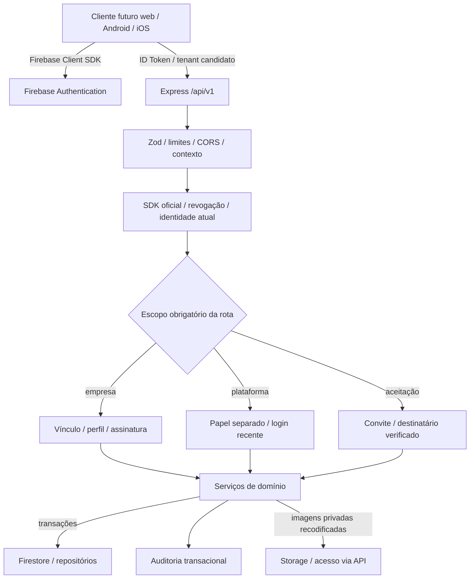

# Arquitetura da fundação

Todas as rotas `/api/v1` compartilham autenticação; o registro exige escopo. Rotas empresariais exigem permissão explícita e passam pelo gate central de vínculo/assinatura. Serviços revalidam autorização dentro das transações de escrita para evitar uma decisão antiga após suspensão ou alteração de perfil. Identidade, empresa e assinatura são relidas sem cache de permissões.

Não há papel Super Admin dentro dos perfis empresariais. Um operador de plataforma só acessa dados empresariais se também tiver recebido e aceitado um vínculo legítimo; seu papel de plataforma sozinho é insuficiente.

Empresa é ativada ao aceitar o primeiro convite de administrador. `active` e `past_due` permitem acesso; `suspended` e `canceled` negam. Cancelamento é terminal neste contrato: uma futura contratação requer fluxo explícito, sem reutilizar silenciosamente a assinatura cancelada.

Assinatura: `active → past_due/suspended/canceled`; `past_due → active/suspended/canceled`; `suspended → active/canceled`. Manter o mesmo estado é permitido com nova versão e motivo. O catálogo futuro deverá usar `publicCatalogAllowed`; nesta fase somente a política é implementada e testada, sem rota pública fictícia.

Planos possuem versões imutáveis. Assinaturas armazenam snapshots dos preços e limites; PATCH do plano não atualiza contratos. Alteração explícita de assinatura exige versão esperada e motivo. Datas de início são metadados administrativos, não um agendador automático de ativação.

Capacidade: usuários ativos + convites pendentes não vencidos. As operações de admissão leem e escrevem o documento da empresa, serializando alterações de baixa frequência. A capacidade não depende do número de administradores: dois administradores cabem no plano de duas vagas. Contadores de usuários/administradores são internos e atualizados somente nas transações correspondentes.

A organização sob tenant ajuda a limitar consultas, mas o Admin SDK ignora Security Rules. As regras fornecidas negam acesso direto de clientes; as permissões comerciais são verificadas no backend. IAM produtivo não fornece isolamento por documento para este serviço compartilhado; comprometimento do serviço permanece risco residual.

Health live não consulta banco; ready testa uma leitura do Firestore. Logs HTTP registram requestId, método, template de rota, estado e duração, sem body, query, email ou token. Auditoria faz parte da transação, em coleção do tenant ou da plataforma conforme o domínio da ação.

A Fase B usa serviços de clientes, produtos e categorias com referências empresariais e consultas limitadas. Escritas ocorrem no recurso, reserva de unicidade e auditoria; não atualizam contadores da empresa. Carteira é propriedade atual (assignedTo), verificada na consulta e no recurso, inclusive na transação. Versão do cliente protege transferências concorrentes.

Fase G acrescenta somente projeções binárias privadas: PDFs A4 comerciais/operacionais sob demanda e quatro CSVs administrativos por página. OrderService reutiliza gates de pedido/carteira em snapshot readOnly; guards operacionais provam expedição/recebimento. Renderizador PDF roda fora do Firestore; serviço revalida antes da entrega. Exportações usam leitores existentes, DTOs explícitos, cursores e gates administrativos. Limites de bytes/páginas/tempo/candidatos/concorrência e contador por UID protegem recursos. Nenhum PDF/CSV fica no Storage ou modifica domínio. Administração existente foi validada sem ampliar papel de plataforma, alterar plano inicial de duas vagas ou duplicar endpoints.

Firestore e Storage não têm transação conjunta. Upload cria objeto privado imutável, depois associa sua referência ao produto numa transação que revalida acesso/versão. Falha tenta excluir somente o objeto daquela tentativa. Substituição/remoção preserva objetos antigos inacessíveis pela API; limpeza de órfãos e retenção precisam de política antes de produção.

Estoque usa documento por tenant/produto como agregado serializado, sem contador global da empresa. Entradas e ajustes leem autorização, idempotência, produto e saldo antes de gravar saldo/movimento/operação/auditoria. Nenhum HTTP, Storage ou efeito externo ocorre dentro do callback repetível. Consultas de saldo e páginas usam snapshot transacional de leitura; necessidade de reposição é uma projeção atualizada no mesmo commit de saldo/produto.

Fase D integra pedido real, reservas por linha, saldos/movimentos, recebíveis iniciais, evento, auditoria e resultado idempotente na mesma transação. Adaptadores prepare→apply terminam todas as leituras antes de escrever; nenhum efeito externo em callback repetível. Preço vigente é relido e snapshot confirmado preservado. Carteira/responsável/estado e aprovação de desconto são verificados em cada recurso/operação. Pedido tem UUID comercial sem contador global; sem teto comercial de produtos, até doze parcelas. Bytes e prazos técnicos continuam aplicáveis; não dividir confirmação para contorná-los. Rascunho incompleto não cria estoque/recebível. Cancelamento financeiro futuro deve atualizar guard por pedido junto aos pagamentos para serializar a corrida contra cancelamento operacional. Ver [Fase D](../phase-d.md) e [Fase E](../phase-e.md).

Fase E implementa cadastros de condições/formas, seletores comerciais, preview, títulos derivados, recebimentos, estornos, créditos legítimos e obrigações/confirmacões manuais. Guard financeiro, projeções, fontes, diário, auditoria e idempotência compartilham commit. Cancelamento de confirmado também libera reservas nesse commit. Devolução de expedido mantém agregado próprio com recebimentos físicos parciais e resolução financeira separada; nenhum efeito financeiro sobre quantidade apenas pretendida. Dano não aumenta estoque disponível. Bloqueio afeta somente o pedido em retorno; contador é parte do diário financeiro validado.

Fase F mantém registro central de rotas e adiciona scope public com router separado antes da autenticação privada. Slug reservado resolve tenant internamente; configuração/status/assinatura/publicação são relidos no snapshot. DTO explícito publica somente informação selecionada, sem saldo ou autoria. Imagens são lidas fora da transação e revalidadas depois do Storage, mantendo objetos privados.

Configuração, reserva do slug, auditoria e idempotência administrativas compartilham commit. Orçamento/WhatsApp são consultas transitórias, sem escrita em domínio comercial ou efeito externo; somente contadores antiabuso independentes usam Firestore. HMAC vincula revisão aos dados públicos atuais; preço oculto não compõe prova. Cursores públicos cifram candidatos privados. CORS/limites públicos são separados dos privados e cache é no-store. Não há coleção de orçamentos, fila, envio de mensagem ou acesso direto por cliente.
