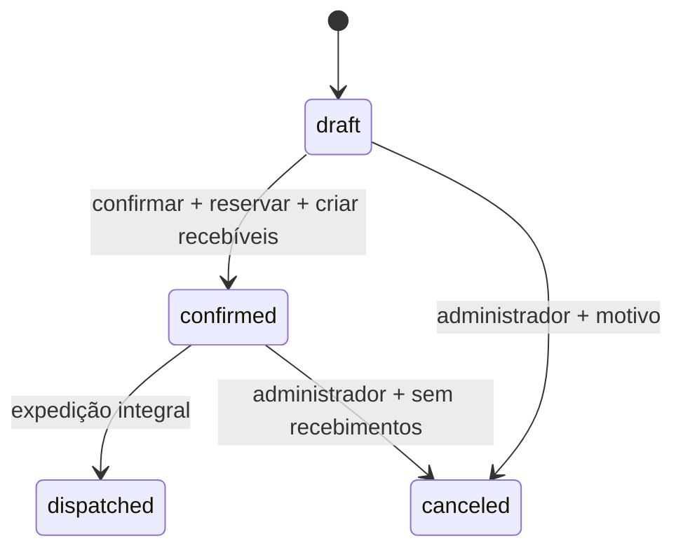

# Fase D — Pedidos, reservas e recebíveis iniciais

Implementação local em 8/10/2026. Integra A/B/C sem deploy, commit, push, produção, recursos pagos ou alterações na Atual Pet. Pagamentos/devoluções/créditos ficam fora de D e agora são implementados separadamente em [E](phase-e.md). Resultados D em [validação histórica da revisão](validation-phase-d-revision.md); resultado vigente em [validação](validation.md). Fiscal, catálogo público e frontend permanecem futuros.

## API e acesso

Base /api/v1; Bearer Firebase, X-Tenant-Id candidato, identidade/vínculo/empresa ativos e gate de assinatura. Autorização é relida na transação, inclusive replay. Entradas Zod strict; saídas omitem tenantId/schemaVersion. JSON máximo 64 KiB.

| Método | Rota                  | Regra                                                           |
| ------ | --------------------- | --------------------------------------------------------------- |
| GET    | /orders               | Administrador: todos; vendedor: responsável + carteira atual    |
| POST   | /orders               | Cria rascunho; vendedor apenas própria carteira                 |
| GET    | /orders/{id}          | Autorização por recurso                                         |
| PATCH  | /orders/{id}          | Somente rascunho, expectedVersion                               |
| POST   | /orders/{id}/confirm  | Administrador ou vendedor autorizado; versão + UUID idempotente |
| POST   | /orders/{id}/dispatch | Mesmo controle; expedição integral                              |
| POST   | /orders/{id}/cancel   | Somente administrador; versão + motivo + UUID idempotente       |
| GET    | /orders/{id}/history  | Autorização do pedido e página por versão                       |

Oito operações novas; 51 no OpenAPI 3.1. Sem endpoints financeiros ou reservas livres. POST de rascunho não é idempotente: retry cego pode duplicar rascunhos. Identificador comercial PED-UUID completo, gerado pelo servidor e único por documento, sem contador global ou sequência fiscal.

Vendedor deve ser responsável pelo pedido E responsável atual pelo cliente. Transferência bloqueia vendedor anterior; o novo não herda pedidos históricos de outro responsável. Administradores preservam acesso. Só rascunho permite alterar responsável/cliente administrativamente; responsável precisa de identidade/vínculo ativos na empresa. Administrador pode indicar membro ativo (inclusive administrador), ou omitir sellerUid e assumir o pedido; vendedor sempre assume o próprio UID. Cliente inativo impede criação/edição comercial/confirmação, preservando expedição/cancelamento do compromisso existente sob autorização.

Listagem filtra sellerUid no índice e confere carteira por candidato no snapshot. Pode retornar página vazia com nextCursor; continuar enquanto houver cursor. Não varre para completar página ou revelar total global. Filtros status/customerId, createdAt asc/desc, desempate documentId, 25 padrão/100 máximo. Histórico por orderId/version/documentId. Cursores assinados por ator/tenant/filtros/ordem/limite/recurso.

## Estados

Dispatched/canceled são terminais nesta fase. PATCH fora de draft, reconfirmação, expedição parcial e cancelamento simples de expedido são rejeitados. Replay exato retorna resultado original; nova chave para transição já aplicada não repete efeitos. Eventos append-only pela API registram criação/edição/transições, versão, estados anterior/novo, ator, data UTC, motivo, requestId e operationId. Auditoria integra o commit.

## Valores, snapshots e descontos

Linhas recebem somente productId/quantity. Sem teto comercial de produtos distintos; repetidos são rejeitados. IDs de linha vêm do servidor; substituição das linhas do rascunho cria novas identidades antes das reservas. Nome/SKU/descrição/unidade/preço vêm de produtos ativos. Quantidades textuais e escala 1000 reaproveitam C. Dinheiro em centavos inteiros; subtotal/total máximo 100.000.000. Preço×quantidade calculado com BigInt e half-up por subtotal de linha. Confirmação relê/recalcula preços; inatividade ou unidade diferente bloqueiam. Sem desconto usa preço vigente. Snapshot confirmado não muda na expedição/cancelamento por alterações futuras do produto.

Administrador envia discount={type:fixed|percentage,value,reason}. Fixed em centavos positivos; percentage em pontos base inteiros (1000=10%), até 10000. Ausência/null no PATCH administrativo remove desconto. Motivo 3..200 caracteres. Desconto nunca excede subtotal; percentual half-up. Distribuição proporcional por maior resto, desempate pela ordem original das linhas; soma exata e nenhuma linha negativa.

Aprovação guarda administrador/data/versão/fingerprint de cliente/responsável/linhas/condições e totais antes/depois. Confirmação exige aprovador ainda administrador ativo, versão e condições iguais. Mudança de preço, descrição, SKU ou condições retorna DISCOUNT_APPROVAL_REQUIRED (409), inclusive ao administrador; reaprovar por PATCH explícito com nova versão/discount.

Qualquer edição invalida a aprovação e remove desconto no recálculo do servidor, inclusive notas. Só discount explícito de administrador reaprova. Vendedor não envia discount (nem null) ou sellerUid: 403. O frontend deve informar invalidação antes de editar; reaprovar se desejar manter o benefício. Vendedor pode confirmar rascunho aprovado intacto, respeitando carteira/pedido.

## Parcelas e recebíveis

Payment={type:cash|installments,dueDates:[YYYY-MM-DD,...]}. Cash exige 1; installments 2..12. Datas reais, atuais/futuras no fuso IANA da empresa e não decrescentes, revalidadas na confirmação. Datas iguais permitidas; sem intervalos automáticos, emissão bancária ou agendamento. Rascunho pode ter total zero ou não ter condição/parcelas. Confirmação exige total final positivo, sem mínimo comercial; parcelas zero podem resultar da divisão de total positivo e não representam dinheiro recebido.

Quociente inteiro e restos nas primeiras parcelas: 100000/3=33334,33333,33333. ID SHA256(receivable:orderId:parcela), número/data/valor/pedido estáveis. Confirmação cria receivables atomicamente: originalCents=outstandingCents, receivedCents=0, status=open, tenant/order/parcela, origem order_confirmation e timestamps. Sem endpoint para saldo editável.

Cancelamento confirmado verifica parcelas/guard e ausência de pagamentos. Altera status=canceled/outstandingCents=0 preservando original/origem. Qualquer recebimento, saldo divergente, parcela ausente/alterada ou registro financeiro bloqueia; não apaga pagamento ou presume reembolso. Contratos futuros em [Fase E](phase-e.md).

## Transação, estoque e retries

OrderService lê contexto/pedido/carteira/idempotência/versão/estado/produtos/aprovação. Adaptadores InitialOrderReceivables e FirestoreOrderStockAdapter preparam todas as leituras. O adapter relê pedido legítimo e valida cada linha/identidade/reserva/produto/saldo. Somente depois apply grava pedido/reservas/saldos/movimentos/recebíveis/guard/evento/auditoria/operação. Sem HTTP/Storage/email/efeito externo em callback repetível.

Reserva SHA256(tenant/pedido/linha/produto), quantidade/unidade e status reserved/dispatched/released. Confirmação aumenta reservado; expedição retira físico/reservado; cancelamento libera só reservado. Reserva de outro pedido é rejeitada. Movimentos comerciais usam origem order, UUID do pedido, operação/ator/seq/hash e saldos antes/depois; reconciliação C verifica também esses movimentos. Adapter não aceita retorno operacional; STOCK_RETURN continua apenas aritmética futura.

Chave UUID obrigatória para confirmar/expedir/cancelar, única no domínio de pedidos do tenant. Liga ator/pedido/ação/payload/versão original e snapshot completo. Mesmo comando/ator retorna 200 original mesmo após outra transição; chave divergente é 409. Replay relê carteira/assinatura/vínculo atuais. Sem TTL; limpeza exige política contra replay. Domínio administrativo de estoque tem chaves separadas.

SDK retenta transações contenciosas; pedido e agregados por produto serializam disputas. Em perda de resposta repetir chave/payload; em 409 de versão recarregar e decidir nova intenção. Sem Redis/sharding/fila ou serviço pago.

## Limites, índices e custo

Sem teto comercial de linhas; até doze parcelas. Para N produtos/P parcelas: confirmação escreve 3N+P+5 documentos e faz até 4N+P+12 leituras lógicas com aprovação. Com 200 produtos/doze parcelas: 617 escritas e 824 leituras lógicas. Não há transformações de campo nestas escritas; não confundir o limite oficial de 500 transformações por documento com um teto geral de escritas. Repetição lógica não equivale necessariamente a cobrança distinta; retries e índices acrescentam custo.

Testes confirmam 20/50/100/200 produtos com descrições 2000/nome 160/notas 1000 e doze parcelas, com expedição/cancelamento/replay e reconciliação de todos os produtos. Cenário histórico de dez produtos preservado. Pré-validação conta UTF-8/mapas/arrays conforme fórmula oficial de armazenamento. Resultados em validation.md. JSON não mede protobuf de requisição ou entradas de índice. [Firestore limita documentos a 1 MiB, requisições a 10 MiB e transações a 270s/60s ociosos](https://firebase.google.com/docs/firestore/quotas); [callbacks podem ser repetidos e leituras precedem escritas](https://firebase.google.com/docs/firestore/manage-data/transactions).

Scripts/order-indexes.mjs adiciona 15 índices (14 pedidos, 1 eventos), total 116, sem deploy. Isenções em linhas/parcelas/notas/aprovação/condições/snapshot. Medir índices reais/bytes/latência/custo/contenção antes de declarar capacidade produtiva. Emulação não comprova 100 usuários/SLO/custo para centenas de empresas.

## Arquivos

Revisão do limite comercial: novos technicalSize.ts, tests/helpers/largeOrders.ts, tests/unit/orderSizing.test.ts e tests/{integration,concurrency}/orderCapacity.test.ts. Alterados schemas/orders.ts, modules/orders/orderService.ts, inventory/orderStockAdapter.ts (lookup por Map), middlewares/errorHandler.ts, auth/openapi.ts, helpers/fixture.ts e vitest.config.ts (preparo local da suíte), testes unit/orders e security/orders e título do cenário histórico de dez. Documentação/contrato frontend/OpenAPI/tipos foram atualizados; manifesto completo na validação. Não houve dependência nova ou alteração de regras/índices/infraestrutura nesta revisão.

Criados: src/shared/schemas/orders.ts; src/app/orderRoutes.ts; src/modules/orders/{calculation,orderService}.ts; src/modules/inventory/orderStockAdapter.ts; src/modules/receivables/orderReceivables.ts; scripts/order-indexes.mjs; tests/helpers/orders.ts; tests/{unit,integration,security,concurrency}/orders.test.ts; docs/adr/0007-pedidos-reservas-e-recebiveis.md; docs/phase-e.md; docs/validation-phase-c.md.

Alterados: app.ts/routes.ts; geração OpenAPI; permissions.ts; commercialRepository.ts; inventoryService.ts (reuso interno de stockFor); orderStockContract.ts (lineId/instante e tipos operacionais reais); schemas/inventory.ts (origem order); firestore.indexes.json; README raiz/backend; CONTEXT.md; arquitetura/modelo/permissões/frontend/segurança/validação/phase-d; OpenAPI/tipos gerados. Nenhuma dependência nova. O teste de inventário da API agora exige pedidos reais e continua negando login paralelo/pagamentos fictícios; nenhum dos 152 casos anteriores foi removido/desabilitado.

## Testar

Leia README para emuladores, seed sintético e onboarding por convite. Terminal 1: pwsh -File scripts/npm.ps1 run emulators. Terminal 2: seed:local e dev pelo wrapper. Swagger http://127.0.0.1:3000/docs. Plataforma sem vínculo não opera pedidos.

POST orders: {"customerId":"ID","lines":[{"productId":"PRODUTO","quantity":"2"}],"payment":{"type":"installments","dueDates":["2090-01-01","2090-02-15"]}}. Cadastrar produto/cliente ativos e entrada física suficiente. Confirm/dispatch: {"expectedVersion":N} e UUID nova por intenção; cancel acrescenta reason. Usar versão da última resposta, consultar histórico/estoque/reconciliação.

Pare desenvolvimento antes de test:integration. Execute test, test:integration, typecheck, lint, format:check, build, openapi, types:api e audit:secrets pelo wrapper. Riscos e resultados em security.md/validation.md. Contratos futuros não autorizam pagamentos ou infraestrutura.
