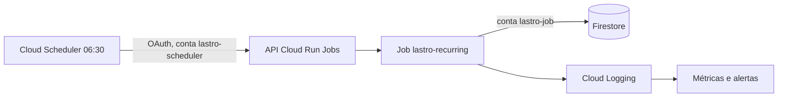

# Lastro Gestão: agendamento das recorrências

Preparado, sem nada criado. Os exemplos usam `lastro-hml`, que tem clientes reais e é produção. **Não ative ali sem autorização.** Valide antes no ambiente de homologação novo, trocando projeto e sufixos.

O código está pronto e foi exercitado em emulador, com execução real, simulação, repetição, paralelismo e falhas isoladas: [recurringRun.test.ts](../../backend/tests/integration/recurringRun.test.ts).

## Desenho



| Requisito     | Como é atendido                                                                                                  |
| ------------- | ---------------------------------------------------------------------------------------------------------------- |
| Idempotência  | Id do título vem da recorrência e da data, conferido na transação. Repetir ou rodar em paralelo não duplica      |
| Autenticação  | Sem endpoint público. O agendador chama a API do Google com token OAuth de conta própria, e só ele pode acionar  |
| Menor acesso  | Duas contas: uma só aciona, outra só lê e grava no Firestore                                                     |
| Isolamento    | Falha fica na empresa ou na recorrência. As demais seguem                                                        |
| Falha         | Código de saída 1, uma nova tentativa automática. Só emite o que faltou                                          |
| Logs          | JSON com `severity`, lido pelo Cloud Logging. Não inclui dados de cliente                                        |
| Plano         | Só empresas com `finance.payables`. Assinatura suspensa ou cancelada é ignorada                                  |

## Etapa 1: preparar, sem agendar

Depende de aprovação. Cria recursos sem execução automática.

```bash
gcloud services enable cloudscheduler.googleapis.com --project=lastro-hml
```

```bash
gcloud iam service-accounts create lastro-job-hml --project=lastro-hml --display-name="Lastro jobs"
```

```bash
gcloud iam service-accounts create lastro-scheduler-hml --project=lastro-hml --display-name="Lastro agendador"
```

```bash
gcloud projects add-iam-policy-binding lastro-hml --member=serviceAccount:lastro-job-hml@lastro-hml.iam.gserviceaccount.com --role=roles/datastore.user --condition=None
```

```bash
gcloud secrets add-iam-policy-binding lastro-invitation-secret --project=lastro-hml --member=serviceAccount:lastro-job-hml@lastro-hml.iam.gserviceaccount.com --role=roles/secretmanager.secretAccessor
```

O job precisa do segredo apenas porque a configuração o exige ao carregar.

```bash
gcloud run jobs create lastro-recurring-hml --project=lastro-hml --region=southamerica-east1 --image=IMAGEM_DA_API_NOVA --service-account=lastro-job-hml@lastro-hml.iam.gserviceaccount.com --command=node --args=dist/src/jobs/recurringExpenses.js --set-env-vars=NODE_ENV=production,FIREBASE_MODE=production,FIREBASE_PROJECT_ID=lastro-hml,STORAGE_BUCKET=lastro-hml.firebasestorage.app,CORS_ORIGINS=https://lastro-hml.vercel.app --set-secrets=INVITATION_SECRET=lastro-invitation-secret:latest --max-retries=1 --task-timeout=15m --tasks=1 --parallelism=1
```

Copie do serviço qualquer variável obrigatória que falte. Só depois de a API nova estar publicada, porque o job usa a mesma imagem.

## Etapa 2: simular

Não grava nada. Critério: `recurring.generation.completed` com `dryRun: true` e `failed: 0`.

```bash
gcloud run jobs execute lastro-recurring-hml --project=lastro-hml --region=southamerica-east1 --wait --args=dist/src/jobs/recurringExpenses.js,--dry-run
```

## Etapa 3: monitoramento

Crie antes de ativar. Definições em [gestao-recorrencias-monitoramento.proposal.json](gestao-recorrencias-monitoramento.proposal.json).

| Alerta               | Dispara quando                                       |
| -------------------- | ---------------------------------------------------- |
| Falha na geração     | Algum log `ERROR` do job com evento `recurring.generation.*` |
| Execução ausente     | Nenhum `recurring.generation.completed` em 26 horas  |

O segundo é o mais importante: um agendador desligado não gera erro nenhum. Ele exige agendamento ativo, então só entra na Etapa 4.

## Etapa 4: ativar

Só com autorização específica. Em produção, só depois de homologação estável.

```bash
gcloud run jobs add-iam-policy-binding lastro-recurring-hml --project=lastro-hml --region=southamerica-east1 --member=serviceAccount:lastro-scheduler-hml@lastro-hml.iam.gserviceaccount.com --role=roles/run.invoker
```

```bash
gcloud scheduler jobs create http lastro-recurring-daily --project=lastro-hml --location=southamerica-east1 --schedule="30 6 * * *" --time-zone="America/Sao_Paulo" --http-method=POST --uri="https://run.googleapis.com/v2/projects/lastro-hml/locations/southamerica-east1/jobs/lastro-recurring-hml:run" --oauth-service-account-email=lastro-scheduler-hml@lastro-hml.iam.gserviceaccount.com --oauth-token-scope=https://www.googleapis.com/auth/cloud-platform --max-retry-attempts=0 --attempt-deadline=60s
```

O agendador não repete sozinho porque a tentativa extra já está no job. `:run` responde assim que a execução começa, então 60 s bastam.

Confira a primeira execução no dia seguinte: `failed: 0` e títulos criados na empresa de teste.

## Operação

| Situação                 | Ação                                                                                       |
| ------------------------ | ------------------------------------------------------------------------------------------ |
| Pausar                   | `gcloud scheduler jobs pause lastro-recurring-daily --location=southamerica-east1`         |
| Falha em uma recorrência | Veja `recurring.generation.recurrence_failed`, corrija o dado, execute o job de novo        |
| Execução perdida         | Execute o job manualmente. A recuperação alcança 60 dias                                   |
| Nova imagem da API       | `gcloud run jobs update lastro-recurring-hml --image=IMAGEM_DA_API`                        |
| Empresa aguardando       | O botão "Gerar títulos agora" aplica a mesma regra                                         |

## Custo

Confirme na [tabela do Cloud Scheduler](https://cloud.google.com/scheduler/pricing) e no console antes de aprovar. Pela referência conhecida, são 3 agendamentos gratuitos por conta de faturamento e US$ 0,10 por agendamento ao mês depois disso. O job usa CPU e memória por poucos segundos ao dia, com leituras e escritas no Firestore. Métricas de log e condições de alerta podem ter cobrança própria. Nada disso foi orçado contra os créditos de teste.
